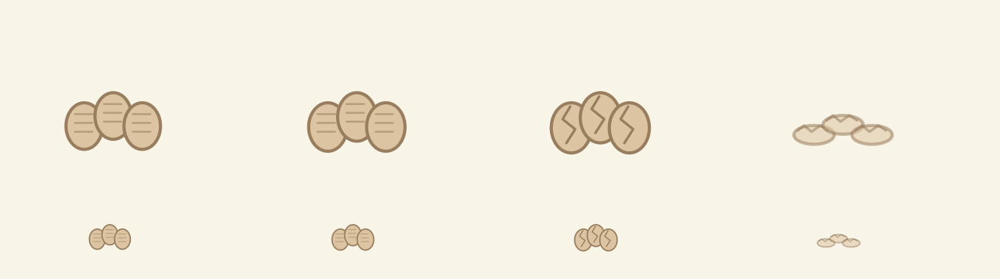

# 1.7.1 — Readable Emergence results

2026-09-11 · Apple Silicon / macOS · baseline 1b0ea3c (1.7.0). All experiment seeds and criteria were written in the plan before implementation. No parameter search: one treatment candidate.

## 1. What changed

Added saved migration hysteresis/history and egg-parent identity metadata in Swift/C#. Added native presentation for chemical residue, activity crumbs, migration departure/transit/arrival and egg development/hatching. Added fresh isolated blind sessions with buffered anonymous local logs, observer materials and launchers. Updated tests, version, README and release packaging. No new gameplay content or pages.

## 2. Hysteresis design

Existing habitat preference remains nestability × .6 + food × (.4 + hunger) − disturbance × 1.4 − chemical × 2 − pressure × .4 + safety × .2 + .08 location-memory bonus. The same ordered maximum and 2-second simulation step remain.

Treatment requires > .30 advantage plus a .12 destination bonus that decays linearly over 90 active seconds. A 30-second commitment supplements the existing shared migration/reproduction cooldown. Chemical > .6, fear + threat > .9, disturbance > .85 or pressure > 2 bypass commitment/cooldown/bonus; a better destination by > .15 is still necessary. Existing flee-or-probability selection remains. This does not force a destination or guarantee survival.

Saved lastMigrationTime defaults to -1, previousLocation/originEgg to empty, counters to zero. Old eggs retain age; old identities, names, partners, notes and earned cards are not reset or backfilled. No offline advancement. Control retains the exact 1.7.0 conditional/random-call ordering; seed-42 F reproduces 251 migrations and 20 deaths.

## 3. Control vs Treatment

Reversal = consecutive A→B then B→A by the same entity within 120 active seconds inclusive; count the second leg once. Rate = reversals / migrations, zero when denominator is zero. No emergency exclusions. Births include new egg entities. Recolonization counts a previously occupied habitat becoming live-occupied again after reaching zero, evaluated after each tick's events. Chemical migration means chemical > .4 at departure (association, not proof of sole cause).

| Scenario | Seed | Mode | Migration | Reversal | Rate | Deaths | Births | Nests | Habitats visited | Recolonization |
| --- | ---: | --- | ---: | ---: | ---: | ---: | ---: | ---: | ---: | ---: |
| F | 7 | control | 279 | 24 | 8.60% | 24 | 42 | 2 | 3 | 16 |
| F | 7 | treatment | 281 | 10 | 3.56% | 17 | 43 | 2 | 3 | 15 |
| F | 19 | control | 293 | 24 | 8.19% | 19 | 39 | 2 | 3 | 13 |
| F | 19 | treatment | 202 | 2 | 0.99% | 20 | 39 | 2 | 3 | 14 |
| F | 42 | control | 251 | 8 | 3.19% | 20 | 39 | 2 | 3 | 13 |
| F | 42 | treatment | 296 | 15 | 5.07% | 18 | 42 | 2 | 3 | 12 |
| F | 73 | control | 334 | 29 | 8.68% | 19 | 42 | 2 | 3 | 13 |
| F | 73 | treatment | 247 | 3 | 1.21% | 20 | 39 | 2 | 3 | 15 |
| F | 101 | control | 273 | 19 | 6.96% | 22 | 39 | 2 | 3 | 14 |
| F | 101 | treatment | 256 | 7 | 2.73% | 21 | 43 | 2 | 3 | 15 |
| H | 7 | control | 19 | 0 | 0.00% | 7 | 39 | 2 | 2 | 1 |
| H | 7 | treatment | 20 | 0 | 0.00% | 2 | 36 | 2 | 2 | 1 |
| H | 19 | control | 26 | 0 | 0.00% | 0 | 39 | 2 | 2 | 1 |
| H | 19 | treatment | 9 | 0 | 0.00% | 1 | 6 | 2 | 2 | 1 |
| H | 42 | control | 27 | 0 | 0.00% | 0 | 43 | 2 | 2 | 1 |
| H | 42 | treatment | 22 | 0 | 0.00% | 0 | 39 | 2 | 2 | 1 |
| H | 73 | control | 31 | 0 | 0.00% | 3 | 42 | 2 | 2 | 2 |
| H | 73 | treatment | 27 | 0 | 0.00% | 2 | 36 | 2 | 2 | 1 |
| H | 101 | control | 15 | 0 | 0.00% | 2 | 15 | 2 | 2 | 1 |
| H | 101 | treatment | 28 | 0 | 0.00% | 2 | 36 | 2 | 2 | 2 |
| C | 7 | control | 18 | 0 | 0.00% | 4 | 27 | 2 | 3 | 1 |
| C | 7 | treatment | 20 | 0 | 0.00% | 2 | 30 | 2 | 3 | 2 |
| C | 19 | control | 12 | 0 | 0.00% | 5 | 16 | 2 | 2 | 1 |
| C | 19 | treatment | 26 | 0 | 0.00% | 1 | 36 | 2 | 3 | 2 |
| C | 42 | control | 17 | 0 | 0.00% | 5 | 36 | 2 | 3 | 1 |
| C | 42 | treatment | 25 | 0 | 0.00% | 2 | 33 | 2 | 3 | 2 |
| C | 73 | control | 17 | 0 | 0.00% | 5 | 33 | 2 | 3 | 1 |
| C | 73 | treatment | 27 | 0 | 0.00% | 1 | 33 | 2 | 3 | 1 |
| C | 101 | control | 16 | 0 | 0.00% | 4 | 32 | 2 | 3 | 1 |
| C | 101 | treatment | 23 | 0 | 0.00% | 1 | 30 | 2 | 3 | 2 |

Additional guardrail data, same runs:

| Scenario | Seed | Mode | Chemical-associated migrations | First shock departures ≤120s | Final live distribution | Extinction transitions |
| --- | ---: | --- | ---: | ---: | --- | ---: |
| F | 7 | control | 106 | 7 | Archive: 12 | 0 |
| F | 7 | treatment | 122 | 12 | Archive: 17, Downloads: 2 | 0 |
| F | 19 | control | 116 | 8 | Archive: 14, Downloads: 1 | 0 |
| F | 19 | treatment | 90 | 7 | Archive: 13, Downloads: 1 | 0 |
| F | 42 | control | 106 | 11 | Archive: 13, Downloads: 1 | 0 |
| F | 42 | treatment | 129 | 11 | Archive: 16, Downloads: 2 | 0 |
| F | 73 | control | 146 | 12 | Archive: 16, Downloads: 1 | 0 |
| F | 73 | treatment | 108 | 12 | Archive: 14 | 0 |
| F | 101 | control | 112 | 12 | Archive: 12 | 0 |
| F | 101 | treatment | 111 | 11 | Archive: 14, Downloads: 1 | 0 |
| H | 7 | control | 4 | 4 | A: 12, B: 15 | 0 |
| H | 7 | treatment | 6 | 6 | A: 14, B: 16 | 0 |
| H | 19 | control | 7 | 7 | A: 16, B: 18 | 0 |
| H | 19 | treatment | 5 | 5 | A: 2, B: 7 | 0 |
| H | 42 | control | 7 | 7 | A: 19, B: 17 | 0 |
| H | 42 | treatment | 7 | 7 | A: 16, B: 18 | 0 |
| H | 73 | control | 11 | 11 | A: 16, B: 17 | 0 |
| H | 73 | treatment | 10 | 10 | A: 15, B: 15 | 0 |
| H | 101 | control | 4 | 4 | A: 9, B: 7 | 0 |
| H | 101 | treatment | 12 | 12 | A: 14, B: 16 | 0 |
| C | 7 | control | 8 | 8 | Archive: 12, Downloads: 10, edge: 2 | 0 |
| C | 7 | treatment | 10 | 10 | Archive: 13, Downloads: 13, edge: 4 | 0 |
| C | 19 | control | 5 | 5 | Archive: 8, Downloads: 5 | 0 |
| C | 19 | treatment | 9 | 9 | Archive: 15, Downloads: 15, edge: 5 | 0 |
| C | 42 | control | 5 | 5 | Archive: 14, Downloads: 13, edge: 4 | 0 |
| C | 42 | treatment | 8 | 8 | Archive: 14, Downloads: 13, edge: 5 | 0 |
| C | 73 | control | 4 | 4 | Archive: 13, Downloads: 12, edge: 4 | 0 |
| C | 73 | treatment | 8 | 8 | Archive: 15, Downloads: 14, edge: 4 | 0 |
| C | 101 | control | 8 | 8 | Archive: 12, Downloads: 11, edge: 5 | 0 |
| C | 101 | treatment | 11 | 11 | Archive: 15, Downloads: 12, edge: 4 | 0 |

Full machine-readable results, including real events for the five C chains: [evidence](readable-emergence-v1.7.1-evidence.json). All raw runs regenerate under build/simulation using the checked-in fixed seeds/configuration.

## 4. Stability result

**PARTIAL overall. Primary F criterion: PASS.** Pooled reversal rate: 7.27% → 2.89%, a 60.3% decrease; 4/5 seeds improve. Seed 42 worsens (3.19% → 5.07%), and total migration rises from 251 to 296. A lower aggregate rate is not a claim that every individual behavior improved.

H is **inconclusive for oscillation**: both groups produced zero 120-second reversals across all five seeds. The frozen equal-habitat fixture is not a sensitive oscillation stress test. It does verify interruption by a chemical shock. We did not change its inputs/window or search more parameters after seeing this. This limitation prevents an overall stability PASS.

## 5. Ecology guardrails

All pre-registered guardrails pass. All five treatment F/C seeds visit at least two habitats and form nests. Pooled final live population is 114.3% of control in F and 128.8% in C. Every H seed leaves the shocked habitat within 120 seconds. The strict C chain (post-shock migration to Archive → Archive nest → actual child birth → that generation returns to Downloads → Downloads nest) survives in all five seeds; representative event sequences are retained in evidence.

F still has 202–296 migrations, 12–15 recolonizations and nonzero deaths/births; it is not frozen. A–I replay/parity and no-egg/empty-world controls pass. D/I still clear adults, retain eggs and later hatch babies; the no-egg control stays extinct. [I state/event timeline](readable-recovery-timeline.json) includes egg ages, juvenile counts, actual hatches, movements and nest formation; it is not human comprehension evidence.

## 6. Readability changes

- **Chemical:** existing hand-held spray and nearby sprite shake on click; faint green-white foam patches persist at the sprayed habitat anchor and fade with actual chemical decay. Cleaning actual habitat state removes the cue. No flashing label or chemical value.
- **Migration:** a visible migrating identity keeps its current position, turns toward one exit and walks offscreen. It then stays hidden for at least four active simulation seconds before appearing at the destination anchor. A new real decision during transit updates the destination without teleporting the sprite. Right-click/hover still take priority.
- **Nest:** small crumbs increase with actual stable occupancy/activity before a nest exists; a real nest maintains a denser trace. At most eight habitat cue overlays are shown; existing discovered-trace interaction is a small crumb patch at the corresponding habitat, replacing the fixed text button.
- **Egg:** a 52-point desktop cluster grows slightly; later shells show cracks. After a real hatch, a faint broken empty shell remains at the original position for 12 active seconds. No countdown or alert.
- **Recovery:** newly projected babies retain their actual parent egg's on-screen origin and move away from it. Parent metadata persists but does not alter growth or spawn counts. Maturation remains the existing World rule.



## 7. Script audit

No ChemicalMigrationStory, EggRevengeStory, forced nest walk, emergency spawn or director expansion. Drawing and presentation functions do not write World state. Real migration/hatch events may start presentation routes/shell artifacts, but cannot add ecological residents, kill them, change habitat scores or create nests.

Presentation special cases: actual hatch stores parent identity; native adapters use the prior egg position for juveniles, and a temporary shell overlay for the removed egg. True migration delays visual arrival while logical World location changes immediately. Fallback anonymous screen-edge anchors represent habitats whose native windows are unavailable. The eight-cue / three-visiting-resident budgets limit visibility, not ecology. Existing explicit player recall/explore/interaction commands remain gameplay commands, not automatic story triggers.

## 8. Performance

Current Apple Silicon host, `/usr/bin/time -l`, 30-second isolated `--benchmark-idle` sessions (add `--paused` for paused/hidden). RSS is maximum resident set, not heap size. Short native runs use existing variable presentation paths; these are observations, not a controlled identical-frame benchmark.

| Run | CPU seconds | Real seconds | Single-core CPU | Max RSS MiB |
| --- | ---: | ---: | ---: | ---: |
| 1.7.0 historical paused | 0.24 | 31.56 | 0.76% | 101.7 |
| 1.7.0 historical active | 0.96 | 31.73 | 3.03% | 118.3 |
| 1.7.1 development paused | 0.23 | 31.60 | 0.73% | 101.2 |
| 1.7.1 development active | 1.28 | 30.23 | 4.23% | 120.4 |
| 1.7.1 release paused | 0.30 | 31.57 | 0.95% | 102.0 |
| 1.7.1 release active | 2.65 | 30.20 | 8.77% | 119.1 |
| 1.7.0 current-machine recheck active | 2.40 | 30.20 | 7.95% | 120.5 |

The release active run is higher than the historical 3.03% baseline. Rather than label that an improvement, we reran the unmodified desktop 1.7.0 binary on the same current host: it also measured 7.95%. The observed current pair is 7.95% → 8.77% (about +0.82 percentage points), with similar RSS. Earlier 1.7.1 development runs are retained above rather than discarded. Different visibility, native drawing/window composition and host conditions are plausible contributors; this short experiment cannot isolate their individual cost. A five-second startup sample was mostly in the main event-loop wait and did not establish a World-model hotspot. No claim of a proven CPU optimization. The simulation is demonstrably not evaluated every frame; native movement still is.

Raw numeric summaries: [performance evidence](readable-performance.json). These historical/current results must not be generalized across machines.


Simulation remains a 2-second tick. Habitat snapshots update at that frequency; persistent cues and static eggs/corpses do not animate at 30 Hz. Only movement/short tool feedback uses the existing frame timer. Dirty saves/logs are batched every ~30 seconds and on normal exit; no high-frequency disk writes.

## 9. Tests

Actual commands:

```sh
./build.sh
'build/universal/旮旯乐园.app/Contents/MacOS/GalaParadise' --integration-test
build/toolchain/dotnet/dotnet run --project Tests/CoreTests -c Release
python3 Tests/Simulation/readable.py
python3 Tests/Simulation/readable-guardrails.py
./package-release.sh
```

Passed: existing Swift/C# gameplay model tests; hysteresis, commitment, chemical/disturbance/threat interruption, inclusive reversal boundary, missing save fields, PRNG continuation, privacy allowlist and unique isolated session paths. Cross-language A–I complete World/events/samples plus multi-seed F/H/C parity; repeated-seed replay; Swift-to-C# mid-run continuation; extinction controls.

Mac native component integration passed: residue snapshot, migration retains coordinates and direction, hidden transit, delayed arrival, same-origin babies/parent IDs, empty shell, actual vector rendering, pause suppression, focus, right-click action routing, Life/naming and minimize/menu/restore. Windows projection-model tests cover departure without teleport, chemical snapshots, actual parent-origin hatch and shell; WinForms builds and self-contained publish succeed. Mac arm64 and x86_64 compile and combine into Universal; Intel hardware not exercised.

The former chemical-settlement test relied on a 1000-second movement lock guaranteeing death. That assumption conflicts with required emergency interruption. It initially failed on both languages; the settlement fixture now provides only one habitat, so the existing exactly-once kill/capture accounting is tested independently of escape. No production death rule was altered to satisfy it.

Mac runtime isolation passed in two actual fresh sessions: (1) the release binary with `--blind-playtest --benchmark-idle --world-log`, and (2) the launcher extracted from the friend ZIP, using normal UI followed by normal quit. Both wrote separate saves/logs with fresh economy and matching hidden seed records. SHA-256 fingerprints of all five pre-existing formal JSON files remained unchanged. No world seed/event stream appeared on stdout when `--world-log` was combined with blind mode. Unit tests additionally submitted sentinel private text/raw habitat values and verified their exclusion from logs. These were developer checks, not human playtests.

Mac ZIP was extracted with native `ditto`; app signature, UTF-8 filenames, executable fresh-session launcher, version and absence of saves were checked. Windows ZIP CRC, launcher and save exclusion were checked. All package artifacts are 1.7.1.

## 10. Known issues

- F seed 42 worsens, other reversals remain, and H did not produce its intended oscillation. Do not describe hysteresis as universally solved.
- Clue visibility is unvalidated with humans. The fresh/developing scale difference is intentionally small; eggs/crumbs may still be missed on busy wallpaper. Empty shell lasts only 12 active seconds.
- Logical location changes before visual arrival. Hover can delay departure. When a migrating creature was already hidden or the three-resident budget is full, not every departure is shown. Several children can briefly overlap at the original egg. Native window geometry is session-only and may be stale after a folder moves; fallback anchors approximate hidden habitats.
- Existing saved egg positions are preserved; their anchors may not coincide with new habitat crumbs. Projection is still a Resident compatibility layer, not a spatially exact physical simulation.
- A fresh blind session starts with the existing tool economy. A short test may never gain spray or encounter a full recovery cycle. This release does not silently grant tools or stage ecological events for testers.
- Blind log/saves can lose the final ~30 seconds after an abnormal exit. Files remain local. Normal quit flushes them.
- **Windows native GUI not validated.** Layered windows, hit testing, DPI and Explorer still require Windows hardware. No formal release signing or macOS notarization.

## 11. Human validation status

**READY_FOR_HUMAN_VALIDATION**

No human sessions have been conducted or fabricated. Automated integration invokes actual native components/actions; it does not prove a person notices a clue, forms a hypothesis or understands causality. Observer guide and marker template are blank support materials.

## 12. Next experiment

**One experiment: 3–5-person blind playtest**, using independent fresh sessions and the exact short opening. Observe spontaneous hypotheses, deliberate experiments, causal recall and surprises; compare statements with local events after the session, without prompting an ecological explanation.
