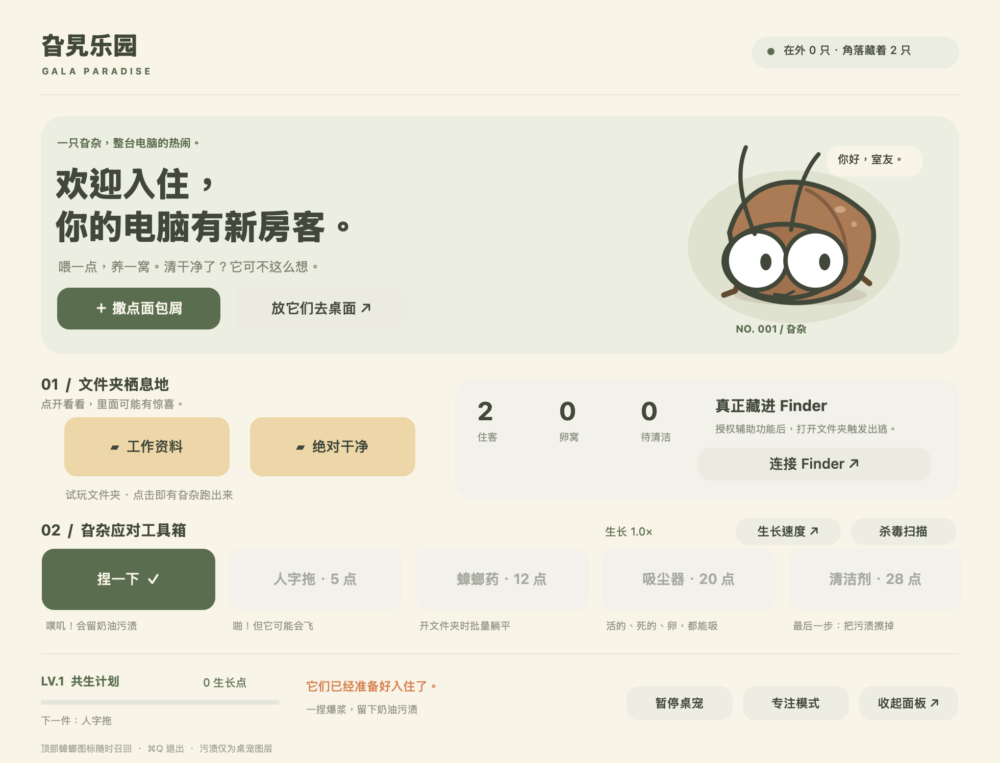

# 旮旯乐园 · Gala Paradise

一只旮杂，整台电脑的热闹。macOS / Windows 原生卡通桌宠，参考大眼睛、棕色豆子身体和细长触须的形象，用代码绘制可缩放的原创矢量角色。



## 1.3 · 文件夹生态

旮杂现在从 Finder／资源管理器窗口四边随机露头，起步时由窗口边缘遮住部分身体，随后向外爬。主面板和顶部／托盘菜单新增「生长速度」（0.25×、1×、3×）与「杀毒扫描」。速度改变卵孵化、幼体成长和繁殖节奏，不改变走路速度。

文件夹联动开启后，只记录应用实际观察到的文件夹进入／切换事件；频繁打开的文件夹少长或不长，闲置后风险逐渐回升。它不是对电脑历史文件使用率的扫描，也不会读取文件内容。每个文件夹首次观察默认有中等风险，记录最多 256 个，存盘使用路径／标识的 SHA-256 摘要。Mac 无法取得路径时会使用窗口标题，因此同名文件夹有可能共用记录。

「杀毒扫描」是游戏内清理：清走住客、尸体和卵，并提供五分钟防护；奶油污渍留给清洁剂手动擦。没有接入真实杀毒软件、不删除真实文件，也没有卸载残留机制。Mac 的新生态设置存在原存档旁的 `habitat.json`；旧养成存档保持兼容。Windows 自动为旧存档补充默认生态设置。

## 1.2 · Mac 和 Windows 朋友测试版

可分享包在 `releases/`：Mac Universal ZIP（Apple Silicon + Intel，macOS 13+）与 Windows x64 ZIP（自带 .NET 运行环境的 EXE）。Windows 使用右下角托盘图标换工具，与 Mac 顶部图标对应。Windows 原生版本位于 `Windows/`，使用 WinForms、透明分层窗口与 Shell COM 读取前台文件夹位置。

Windows 发布包已做交叉编译，跨平台玩法测试位于 `Tests/CoreTests`。本机无法运行 Windows 原生桌面，托盘、窗口、资源管理器需 Windows 真机测试。先退出正在运行的桌宠，再在 Windows 上运行 `GalaParadise.exe --smoke-test`；日志写到 `%TEMP%/GalaParadise-smoke.txt`，不读写玩家存档。`.github/workflows/windows.yml` 提供可手动触发的 Windows CI，尚未上传或执行。

这是未签名内测包，不是已公证／签名的正式发布版。系统阻止时请保留提示反馈，不需更改系统保护。完整朋友测试说明随 ZIP 一起提供。

构建双平台：安装 .NET 10 SDK 和 macOS Command Line Tools，然后执行 `GALA_DOTNET=/path/to/dotnet ./build-release.sh`。开发机已在 `build/toolchain/dotnet/` 放置经 SHA-512 校验的微软官方 SDK，脚本默认使用它。构建脚本与测试源码都不依赖个人存档。

## 1.1 更新

- 顶部常驻的是小蟑螂图标，适配浅色／深色菜单栏。最小化、关闭或收起面板后仍可直接点击图标换工具，菜单显示当前工具并打勾；「打开旮旯乐园」可恢复最小化的窗口。
- 桌面成虫从 98 pt 缩至 68 pt，幼体从 67 pt 缩至 45 pt，卵窝也相应缩小。
- 新增屏幕四边的出入与躲藏状态，平时只有一只随机来访，离开后屏幕可以完全没有活体。喂食和开文件夹仍可主动引出多只。尸体、污渍仍需用对应工具清理。
- 躲藏不依赖 Finder 授权；支持从连接显示器的边缘出现。保存的养成进度和住客保留，重启后住客先躲藏，再出来。

## 打开就能玩

双击桌面上的 **旮旯乐园.app**。不用装 Node、浏览器或其他运行环境。

1. 点「撒点面包屑」养旮杂，每次 +3 生长点，每两次投喂多一窝卵。
2. 点「工作资料」或「绝对干净」试玩文件夹，旮杂从桌面跑出来。每次 +1 生长点。
3. 点「放它们去桌面」收起面板。住客会越过你的普通应用窗口，逛完再爬出屏幕边缘藏好。
4. 从面板或顶部蟑螂图标选工具，再点桌面上的旮杂、卵、尸体或污渍。
5. 关闭面板不会退出桌宠。顶部蟑螂图标可重新打开、换工具、暂停或退出；面板在前台时 ⌘Q 退出。

## 工具与生态

| 工具 | 解锁点数 | 用途 |
| --- | ---: | --- |
| 捏一下 | 0 | 捕捉 +2，变成持久的卡通奶油污渍 |
| 人字拖 | 5 | 拍成翻肚皮的尸体，捕捉 +2 |
| 蟑螂药 | 12 | 投药后，打开文件夹按文件夹风险出现尸体；卵不受影响。菜单栏可收药 |
| 吸尘器 | 20 | 点击吸走活体（包括飞行中）、尸体、卵；不能擦污渍 |
| 清洁剂 | 28 | 点击擦去污渍，清洁 +2 |

成年旮杂被捏或拍时有 24% 概率飞起，约 2.8 秒落地；飞行中普通攻击打不到。卵约 55 秒孵化为两只小旮杂，幼体约 120 秒长大。有活体时周期性留卵，住客平时藏在四周，偶尔从屏幕四边爬出来，约 9–16 秒后开始寻找最近的边缘退出；完全离开后有 22–45 秒的安静间隔，再随机出来一只。孵化的幼体也加入躲藏队伍，不会全部挤在页面上。桌面看似没有活体后，约 24 秒会出现挑衅的「漏网之鱼」。住客与残留总数上限为 38，避免无限增殖。

「专注模式」减速并停止繁殖、随机出逃和文件夹触发；「暂停桌宠」直接隐藏所有桌宠图层。选择工具不会操作真实文件。污渍只是独立透明窗口中的图形，退出应用即隐藏，重新打开会从存档恢复。

## 连接真实 Finder

点面板上的「连接 Finder」，在 macOS「系统设置 → 隐私与安全性 → 辅助功能」中允许 **旮旯乐园**。系统权限需要电脑主人自己操作；授权后应用会自动检测，无需重启。

通过辅助功能读取前台 Finder 的窗口标题、文档位置与窗口坐标。当打开或切换到不同名称／路径的文件夹时，触发旮杂从窗口附近出逃。无需读取文件内容，也不会向真实文件夹写入卵、删除资料或修改 Finder。未授权时，桌面游走和两个试玩文件夹仍完整可用。

范围说明：相同标题且 Finder 不提供路径的窗口无法区分；快速切换低于一秒的文件夹可能合并一次触发。桌宠在普通窗口上方显示；独占全屏和系统安全界面是否显示由 macOS 决定。

## 本地存档

`~/Library/Application Support/GalaParadise/save.json`

保存生长点、工具、住客位置、卵、尸体、污渍、投药及专注状态。状态改变时与每 10 秒原子写入。没有网络请求、账户、遥测、后台开机自启。

## 从源码构建

需要 macOS 13+ 与 Xcode Command Line Tools。`build.sh` 生成当前 Mac 架构的开发版；`package-release.sh` 生成 Mac Universal 和 Windows x64 分享包。

```sh
./build.sh
open build/旮旯乐园.app
```

`build.sh` 编译 AppKit 程序、打包应用、做本地 ad-hoc 签名并执行模型测试。当前应用不是 App Store / Developer ID 公证发行包，分享包目前用于受邀内测。

```sh
# 模型规则（锁定、飞行、工具效果、存档编解码）
build/旮旯乐园.app/Contents/MacOS/GalaParadise --self-test
# 原生窗口及完整生态流程；使用隔离内存状态，不覆盖玩家存档
build/旮旯乐园.app/Contents/MacOS/GalaParadise --integration-test
# 启动冒烟测试，2 秒后退出
build/旮旯乐园.app/Contents/MacOS/GalaParadise --smoke
# 导出应用自身的面板和矢量角色预览，不截取其他应用
build/旮旯乐园.app/Contents/MacOS/GalaParadise --render
```

- `Sources/Game.swift`：可序列化状态、工具效果、规则测试。
- `Sources/Art.swift`：颜色、绘图和角色。
- `Sources/App.swift`：原生面板、菜单栏、生态计时、桌宠窗口、Finder 连接、集成验收。
- `Sources/main.swift`：入口。
- `Resources/`：应用元数据、图标与预览。

辅助功能授权依赖最终应用的位置和签名。更新后若权限失效，在系统设置重新允许最终桌面应用。
