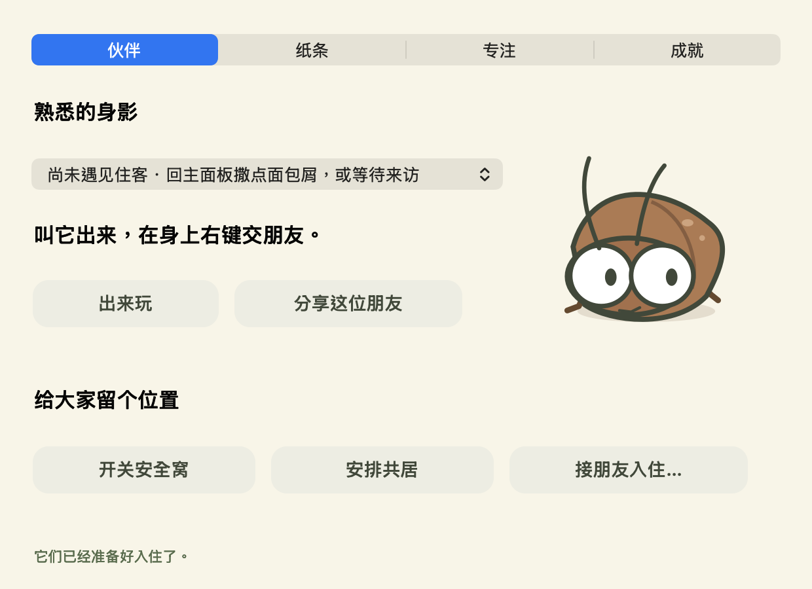
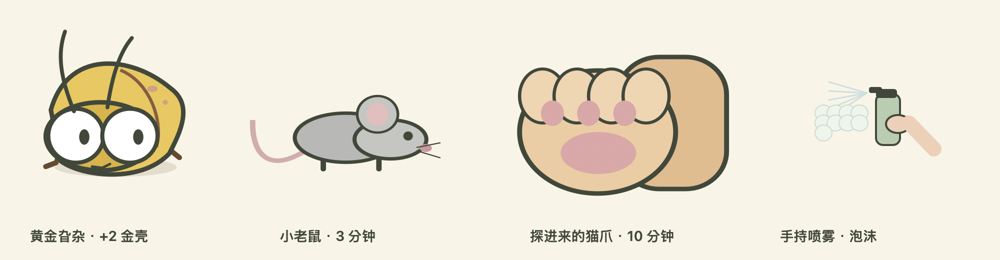

# 旮旯乐园 · Gala Paradise

macOS / Windows 卡通桌宠。旮杂在窗口边缘出没，老鼠偶尔路过，猫把爪子搭在你的桌面上。

## 1.6 · 直接碰它，就有回应


**左键使用当前工具，右键直接交朋友。** Mac 也支持 Control + 单击。鼠标靠近时动物稍停一下，菜单关闭后继续等一会儿；养成互动原地发生，不再要求先在手册里选择动物。

| 工具 | 普通旮杂 | 猫、老鼠与受保护住客 |
| --- | --- | --- |
| 捏一下 | 捕捉、奶油爆浆 | 摸摸、蹭手、呼噜 |
| 人字拖 | 拍打或飞行躲避 | 老鼠闪开、猫爪接住 |
| 蟑螂药 | 喷药 | 打喷嚏、抖掉泡沫 |
| 吸尘器 | 吸走 | 吹乱毛、按住吸嘴 |
| 清洁剂 | 擦去污渍 | 擦脸、闪光 |

点击后动物旁有短气泡、动作和工具效果。连续点击仍有回应，好感冷却只限制数值增长。伤害工具不会永久伤害猫鼠或已命名、已驯养、已领养的住客。

右键菜单提供抚摸、投喂、起名字、成为伙伴；黄金旮杂可收获金壳，猫鼠伙伴可去右侧巡逻。把复杂操作留给菜单，桌面上直接玩。

主界面缩为小工具盒，设置、文件夹联动、试玩和扫描移到右上角「···」及系统菜单。「我的小窝」分为四页，不再把所有功能堆在一张表上。



## 我的小窝与支线

- **伙伴**：召回熟悉的住客、分享领养码、接朋友入住、安全窝与共居。叫出来以后直接在它身上右键互动。
- **纸条**：主动输入文字、链接、待办，点「收好」；随时复制取回、标记完成或删除。动物躲起来也不会丢失内容。
- **专注**：1–120 分钟计时，默认 25 分钟。期间隐藏住客与痕迹并暂停随机事件，结束后获得成就。关闭程序会取消未完成计时，中途结束不扣好感。
- **成就**：22 张里程碑小卡片，包含首次／三次击败、黄金收获、初遇、抚摸、命名、伙伴、收纳、探索、巡逻、共居、专注和领养。只按实际完成的事件结算一次。

抚摸和投喂每 20 秒增加一次信任，信任 6 可成为伙伴（最多 6 位）。命名即受保护。信任 2 可解锁收纳；黄金旮杂信任 2 后可在右键菜单友好收获 **2 枚黄金卵壳**。每个身份只给一次奖励，已收获的住客仍可保留，也不挡住后续黄金访客。

老鼠／猫伙伴可巡逻右半屏 60 秒，只驱赶未受保护的旮杂，不产出击杀或金壳。左半屏可设安全窝，两种伙伴可安排共居。活跃生态约 60 秒会出现可点击的金色碎屑，追踪后发现黄金旮杂的小窝。

内测中老鼠在累计活跃约 3 分钟后可来访，猫咪约 10 分钟；暂停、离线和计时专注不增加发现时长。熟悉动物保留身份并重复来访。老鼠最多同时两只，猫爪最多一只。

## 领养、存档与边界

在伙伴页选择已命名或已驯养的住客，点「分享这位朋友」复制离线 `GALA1:` 领养码。朋友主动粘贴接收，发送方保留原住客，接收方得到新身份的受保护副本。Mac／Windows 使用相同格式，同一码在一个存档中只接收一次。

领养码只含版本、领取标识、物种和名字，不包含纸条、路径、信任、资源或成就。它是未签名的离线游戏数据，没有服务端身份认证。应用不会自动给朋友发送消息。

纸条只处理主动输入的内容，不后台读取剪贴板、文件正文或打字内容。以本地 JSON 保存，尚未加密。选择工具、开启安全窝、扫描都只操作游戏对象，不删除真实文件；「扫描」不是真实杀毒软件。

当前探索为金色碎屑与小窝，区域固定为左右半屏。更丰富的对白、装扮、卡面插画和领养故事仍见[设计草案](Docs/玩法与支线设计草案.md)，尚未制作。

## 桌面生态



普通旮杂尺寸 68，幼体 45，老鼠 170，猫爪 240。猫爪从边缘伸入、落地、停留，再收回；悬停或互动时可停留更久。住客隐藏与出入交替，空白桌面是正常状态。

文件夹联动记录应用观察到的进入／切换事件：经常使用少出虫，闲置逐渐恢复。关闭联动仍可游玩基本支线。生长速度 0.25×／1×／3×影响繁殖，不改变走路速度。旧的安静开关停止随机繁殖，新计时专注还会隐藏住客。

工具兑换：捏取免费；人字拖 2 金壳、蟑螂药 4、吸尘器 6、清洁剂 5。旧存档的工具、金壳、住客关系与纸条保留；没有可信历史数据的成就不会倒推补发。

## 运行、打包与验证

- Mac：macOS 13+，Universal 支持 Apple Silicon / Intel。
- Windows：Windows 10 22H2 / Windows 11 x64，自带 .NET 运行时。
- 收起窗口后，Mac 顶部图标、Windows 托盘图标仍可换工具、打开小窝和退出。
- 更新前先退出旧进程，再打开新版。朋友包不包含开发者存档。
- 发布包：`releases/GalaParadise-1.6-macOS-Universal.zip`、`releases/GalaParadise-1.6-Windows-x64.zip`，附测试说明及校验值。
- Mac 模型与原生集成测试通过；Intel 为交叉构建。Windows 模型与构建已检查，鼠标路由、DPI、右键菜单仍需 Windows 真机验收。未配置正式发行签名／Mac 公证。

```sh
./build.sh
'build/旮旯乐园.app/Contents/MacOS/GalaParadise' --integration-test
'build/旮旯乐园.app/Contents/MacOS/GalaParadise' --render
dotnet run --project Tests/CoreTests -c Release
./package-release.sh
```

需要 Xcode Command Line Tools 与 .NET 10 SDK。脚本支持 `GALA_DOTNET`，也会使用项目已有的 `build/toolchain/dotnet/dotnet`。构建输出不提交 Git。

`DirectInteraction` 处理动物右键菜单与身旁反馈；`Life` 处理关系、成就和收纳；`LifeUI` 是分页面的小窝；`Game / Progression / Habitat` 为原有玩法；`App.swift / Desktop.cs` 管理原生图层与鼠标事件。

存档：Mac `~/Library/Application Support/GalaParadise/save.json`；Windows `%LOCALAPPDATA%/GalaParadise/save.json`。更多见[验证记录](Tests/VALIDATION.md)与[朋友测试说明](Docs/朋友测试说明.txt)。
